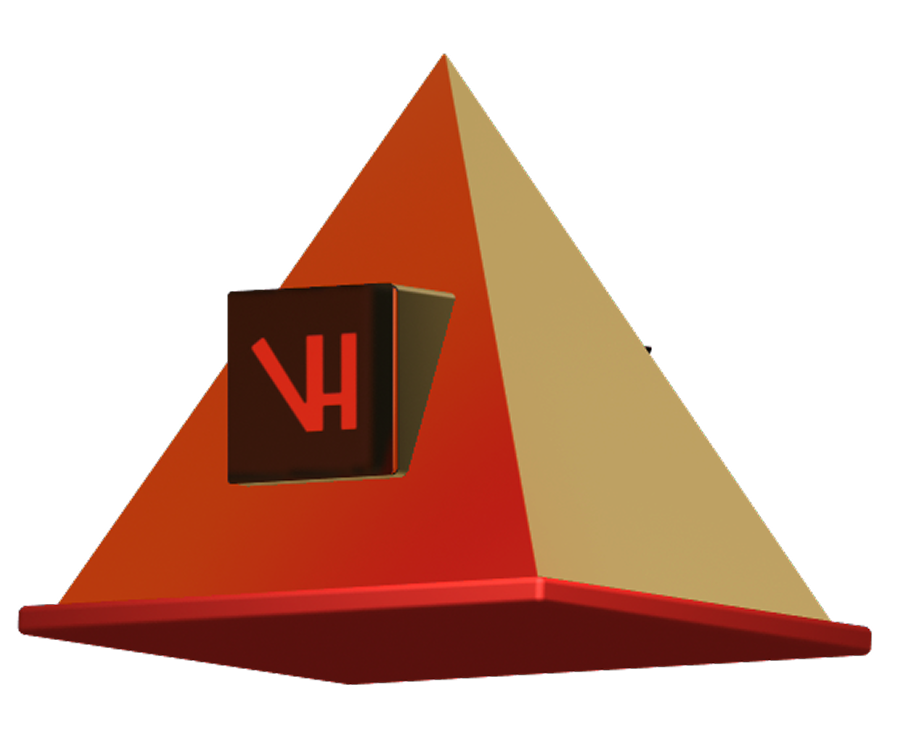

  

<h5 align="center">A passionate frontend developer who loves designing user-friendly and high-performing web applications that are appealing. A React.js, Next.js, JavaScript, and modern technology proficient frontend developer with strong proficiency in creating responsive designs using the principles of UI and UX design. Web Performance and Design Systems enthusiast as well.</h5>

<table width="100%">
<tr>
<td>

### &gt; Hey there! I'm Vhmed Hossam👋

</td>
</tr>
</table>

<table width="100%">
<tr>
<td valign="top">

**Frontend Developer & UI/UX Designer**

I am passionate about crafting minimalist, high-performance web applications and building efficient digital experiences.

Currently, I'm focusing my energy on building modern web applications and exploring new technologies.

My technical playground revolves around React, Next.js, Tailwind CSS, and Node.js, with a passion for creating clean interfaces and seamless user experiences.

</td>

<td align="center" valign="middle">

</td>
</tr>
</table>

 

  
  
  

 

###

